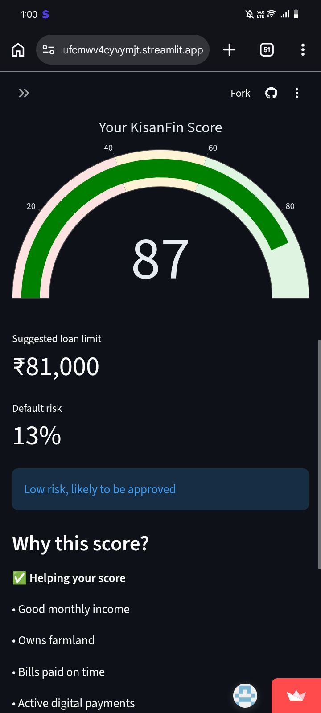
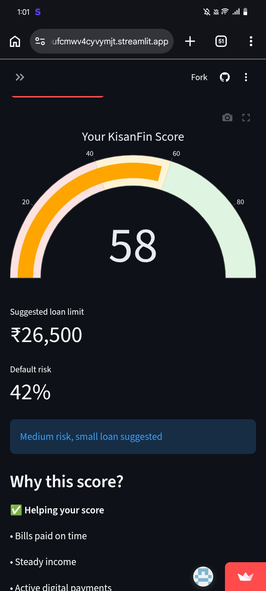
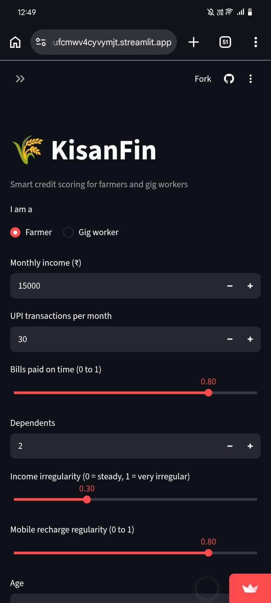

# 🌾 KisanFin: Smart Credit Scoring for Farmers and Gig Workers

**Domain:** AI for Finance | **Event:** SITAMS HackSphere 2026

## Problem
Millions of small farmers and gig workers are rejected by banks or pushed to
moneylenders charging very high interest, because they have no credit history and
their irregular incomes can't be assessed by traditional credit models.

## Solution
KisanFin scores borrowers using alternative data (UPI activity, mobile recharge
regularity, bill payments, income volatility, land or platform tenure). It gives a
0-100 score, a suggested loan limit, plain-language reasons, and tips to improve,
in English and Telugu.

## Features
- Credit score (0-100) with risk gauge
- Suggested loan limit
- Explainable reasons (SHAP-style feature contributions from XGBoost)
- English / Telugu toggle
- "How to improve your score" tips
- Works for both farmers and gig workers

## Tech Stack
Python, Pandas, NumPy, scikit-learn, XGBoost, Streamlit, Plotly.
Hosted on Streamlit Community Cloud.

## Setup
```
pip install -r requirements.txt
python train.py
streamlit run app.py
```

## Live Demo
https://kisanfin-ai-credit-scoring-iybmdxcbufcmwv4cyvymjt.streamlit.app/

## Screenshots
### Strong profile (high score)


### Weak profile (low score)


### Default profile


### Telugu version


## Responsible AI
- The demo uses **synthetic data**, not real customer data.
- Real deployment would use consented data via Account Aggregator, plus fairness audits.
- The score is decision support, not a final lending decision.
- No API keys or secrets are used or stored in this repository.

## AI Disclosure
AI tools were used for brainstorming, code assistance and documentation.
The team reviewed and tested all code.
